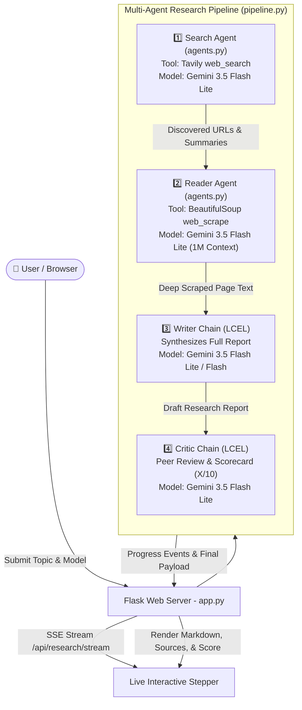

# 🤖 Autonomous Multi-Agent AI Deep Research Engine

An end-to-end, multi-agent research system that automates deep web research, content extraction, structured report authoring, and critical peer review. Powered by **Google Gemini**, **LangChain**, **Tavily**, and a modern **Flask** web frontend with real-time **Server-Sent Events (SSE)**.

---

## 📑 Table of Contents

- [Overview](#overview)
- [System Architecture](#system-architecture)
- [Multi-Agent Pipeline Stages](#multi-agent-pipeline-stages)
- [Model Selection & Free Tier Plan Limits](#model-selection--free-tier-plan-limits)
- [Project Directory Structure](#project-directory-structure)
- [Prerequisites & Installation](#prerequisites--installation)
- [Environment Configuration](#environment-configuration)
- [Running the Application](#running-the-application)
- [API Reference](#api-reference)
- [Key Features](#key-features)
- [Troubleshooting](#troubleshooting)

---

## 🔭 Overview

Conducting thorough online research requires searching multiple sources, reading full articles, synthesizing findings into structured reports, and verifying quality. 

This project orchestrates four specialized agents to complete the entire research lifecycle autonomously in seconds:
1. **Search Agent:** Queries the Tavily Search API for up-to-date, authoritative web sources and links.
2. **Reader Agent:** Fetches and cleans HTML text from the most relevant discovered webpage using BeautifulSoup.
3. **Writer Chain:** Synthesizes the aggregated data into a structured research report with key findings and citations.
4. **Critic Chain:** Objectively reviews the generated report, evaluates factuality and depth, and assigns an audit score (`X/10`).

---

## 🏗️ System Architecture



---

## ⚡ Model Selection & Free Tier Plan Limits

Google AI Studio provides generous free-tier limits, but rapid consecutive agent calls can risk temporary rate limits (`429 Too Many Requests`). This system is designed specifically to optimize speed and stay safely within the free tier plan:

### Recommended Models by Task

| Task / Stage | Recommended Model | Reason & Free Tier Fit |
| :--- | :--- | :--- |
| **Search Agent** | `gemini-3.5-flash-lite` | Ultra-fast tool-calling latency (~1.5s) without unneeded thought token overhead. High RPM. |
| **Reader Agent** | `gemini-3.5-flash-lite` | Massive 1M+ token context window to ingest full web articles effortlessly. |
| **Writer Chain** | `gemini-3.5-flash-lite` / `gemini-3.5-flash` | Produces clean, well-formatted markdown reports with bullet points and citations. |
| **Critic Chain** | `gemini-3.5-flash-lite` | Strictly adheres to the evaluation rubric and score format (`X/10`). |

### Free Tier Limits Reference

- **RPM (Requests Per Minute):** 15 to 30 requests/min.
- **TPM (Tokens Per Minute):** 1,000,000 tokens/min.
- **RPD (Requests Per Day):** 1,500 requests/day.

### Built-in Free Tier Protections in the Code:
1. **Stage Pacing:** 1.0-second delay between pipeline steps prevents burst traffic from tripping the 15 RPM limit.
2. **Scrape Truncation:** Web page scraping is capped at 3,000 clean characters to prevent token bloat (TPM exhaustion).
3. **Automatic Retries:** Exponential backoff (`max_retries=3`) handles transient API hiccups smoothly.

---

## 📂 Project Directory Structure

```text
genrative AI/
├── app.py                  # Flask web server, SSE streaming, and API endpoints
├── main.py                 # Application launcher script
├── pipeline.py             # Pipeline orchestrator managing all 4 agent stages
├── agents.py               # Gemini Agent and LCEL runnable chain definitions
├── tools.py                # LangChain tools (Tavily search & BeautifulSoup scrape)
├── requirements.txt        # Python package dependencies
├── Dockerfile              # Container image definition (Python 3.13 + Gunicorn)
├── .dockerignore           # Excludes .env, .venv, and build artifacts from image
├── .env                    # Secret API keys (GOOGLE_API_KEY, TAVILY_API_KEY)
├── .env.example            # Safe template for API keys
├── .gitignore              # Ignores .venv, .env, and build artifacts
├── templates/
│   └── index.html          # TailwindCSS frontend with live stepper & markdown render
└── static/                 # Static assets directory (optional)
```

---

## ⚙️ Prerequisites & Installation

### 1. Prerequisites
- **Python 3.10+** (Tested on Python 3.13)
- **Google Gemini API Key**: [Get a Google Gemini API Key from Google AI Studio](https://aistudio.google.com/app/apikey)
- **Tavily Search API Key**: [Get a Tavily API Key](https://app.tavily.com)

### 2. Setup Virtual Environment

Using standard Python `venv`:
```bash
python3 -m venv .venv
source .venv/bin/activate
pip install -r requirements.txt
```

Or using `uv` (recommended fast package manager):
```bash
uv venv
source .venv/bin/activate
uv pip install -r requirements.txt
```

---

## 🔐 Environment Configuration

Create or update your `.env` file in the project root:

```env
GOOGLE_API_KEY=AIzaSy...
TAVILY_API_KEY=tvly-...
```

> **Note:** API keys can also be set or changed directly in the browser via the **Settings** modal in the web interface.

---

## 🚀 Running the Application

### Option A: Run the Flask Web Application (Recommended)

Start the server using `main.py`:
```bash
python main.py
```
Or directly with `app.py`:
```bash
python app.py
```

Open your browser and navigate to:
👉 **`http://localhost:5000`**

### Option B: Run via CLI (Terminal Only)

To test or execute research directly in your terminal:
```bash
python pipeline.py
```
You will be prompted to enter a research topic, and logs will print for each stage.

### Option C: Run with Docker

Make sure your `.env` file uses `KEY=VALUE` format without spaces around `=` or surrounding quotes (required by Docker's `--env-file`).

1. **Build the Docker image:**
   ```bash
   docker build -t research-assistant .
   ```

2. **Run the container:**
   ```bash
   docker run --rm -p 5000:5000 --env-file .env research-assistant
   ```

Once running, open **`http://localhost:5000`** in your browser.

---

## 📡 API Reference

### 1. Real-time Research Stream (Server-Sent Events)
- **Endpoint:** `GET /api/research/stream`
- **Query Parameters:**
  - `topic` (string, required): The topic to research.
  - `model` (string, optional): Gemini model (default: `gemini-3.5-flash-lite`).
  - `temperature` (float, optional): Temperature (default: `0.0`).
  - `google_key` (string, optional): Google Gemini API key override.
  - `tavily_key` (string, optional): Tavily API key override.
- **Event Types:**
  - `progress`: Active step status (`running` / `complete`).
  - `complete`: Full final payload with report, critic feedback, score, and timings.
  - `error`: Failure message if an error occurs.

### 2. JSON Research Endpoint
- **Endpoint:** `POST /api/research`
- **Headers:** `Content-Type: application/json`
- **Body:**
  ```json
  {
    "topic": "Quantum Computing Breakthroughs in 2025",
    "model": "gemini-3.5-flash-lite",
    "temperature": 0.0
  }
  ```

---

## 🌟 Key Features

- **Google Gemini Powered:** Uses `gemini-3.5-flash-lite` for lightning-fast tool invocation and report synthesis.
- **Real-Time Live Stepper:** Visual indicators and spinners pulse during execution and transition to checkmarks upon completion.
- **Rendered Markdown:** High-quality rendering of tables, bullet points, headers, and code snippets powered by `marked.js`.
- **Export Options:** Download research reports instantly as `.md` (Markdown) or `.txt` (Plain text), or copy to clipboard with a single click.
- **Critic Peer Review:** Every report receives an automated objective evaluation with scores (`/10`), identified strengths, improvement areas, and a verdict.
- **Session History:** Keeps past research sessions accessible in a slide-out drawer without needing to re-run queries.

---

## 🛠️ Troubleshooting

- **`Google Gemini API Key missing`:** Ensure `.env` contains `GOOGLE_API_KEY` or enter it directly in the **Settings** dialog.
- **`429 ResourceExhausted`:** If you are hitting rate limits on the free plan, ensure you are using `gemini-3.5-flash-lite` (which offers the highest RPM) and wait 1 minute before submitting consecutive searches.
- **`Port 5000 in use`:** Run `PORT=5001 python main.py` or terminate the existing process using `fuser -k 5000/tcp`.
